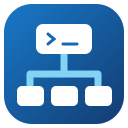
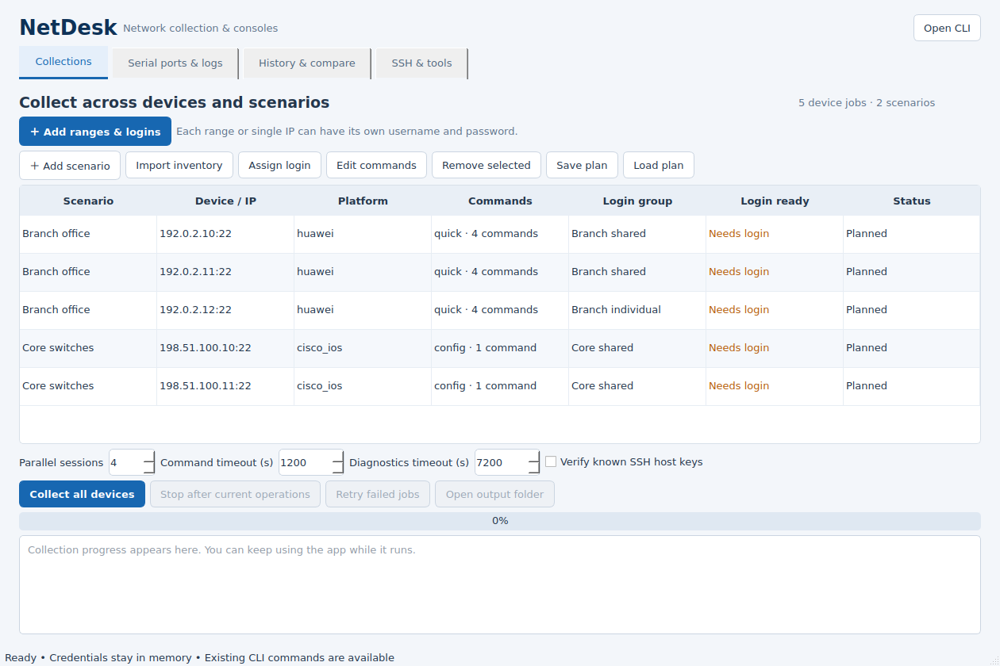
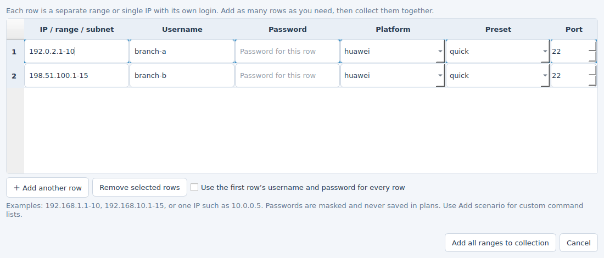
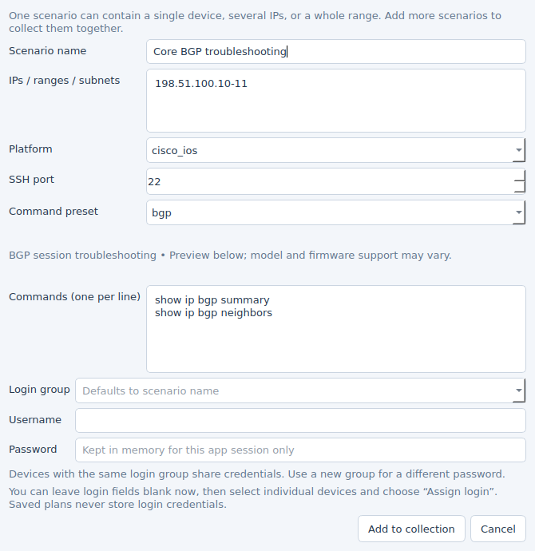
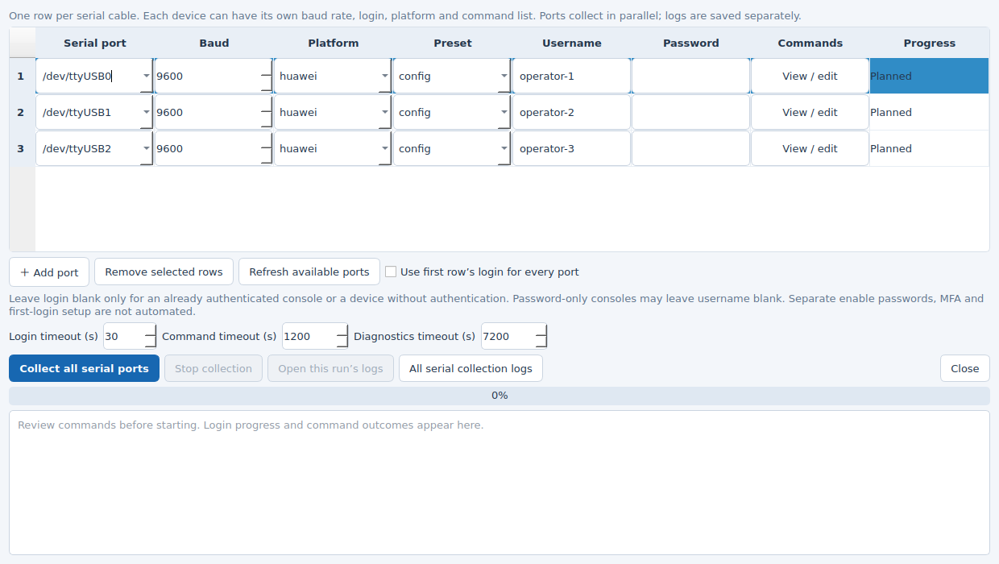
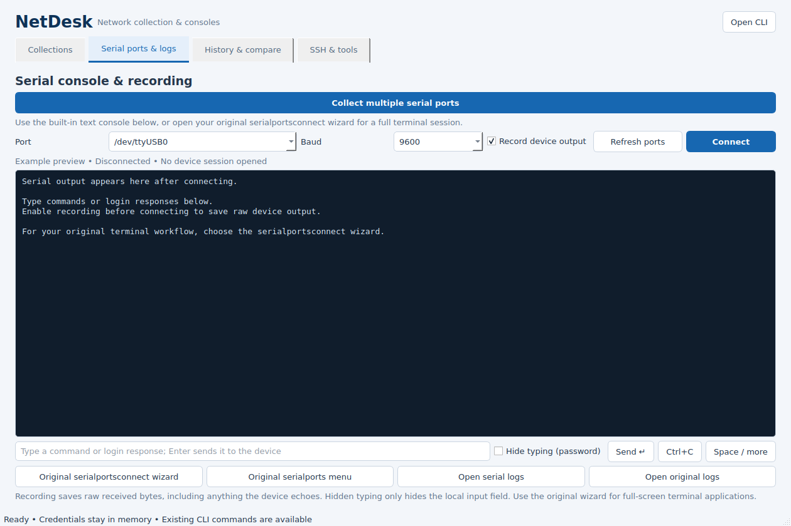

<div align="center">
  
  <h1>NetDesk</h1>
  <p><strong>Collect network-device logs, back up configurations, and record serial consoles—from one desktop app or CLI.</strong></p>
  <p>
    <a href="https://github.com/awesometawkir/netdesk/actions/workflows/tests.yml"></a>
    <a href="LICENSE"></a>
    
  </p>
</div>



NetDesk combines a native **PySide6 desktop GUI**, a guided **terminal interface**, multi-device **SSH collection**, and **serial-console recording**. Build several collection scenarios, assign shared or individual logins, review the commands, and collect the results into separate device folders.

## What it does

- **Multiple scenarios in one run:** mix IPs, inclusive ranges, subnets, device platforms, and command sets.
- **Shared or per-device credentials:** assign named login groups to any selection of devices. Credentials stay in memory.
- **Platform-aware presets:** 15 platform families and 159 platform/scenario combinations for health checks, backups, interfaces, routing, neighbors, VLANs, BGP, OSPF, system status, logs, and selected VPN/session checks.
- **Parallel collection:** up to 16 simultaneous sessions, with same-device jobs serialized across scenarios.
- **Inspectable results:** per-command text, raw SSH session logs, JSON/CSV summaries, explicit failure statuses, and retries.
- **Configuration comparisons:** compare backups from two runs without overwriting previous output.
- **Serial console:** a built-in text console with raw-output recording, plus the original guided `serialports` / `serialportsconnect` terminal workflows.
- **Desktop integration:** an Applications-menu entry, icon, and `netdesk gui` command. The CLI remains available.

## Install on Ubuntu / Debian / Zorin

Requires Python 3.10+ and a graphical Linux session for the GUI. Development and automated checks use Python 3.12. Other operating systems are not currently supported by the installer.

```bash
sudo apt update
sudo apt install -y git python3-venv picocom openssh-client gnome-terminal \
  libegl1 libopengl0 libxcb-cursor0 libxkbcommon-x11-0

git clone https://github.com/awesometawkir/netdesk.git
cd netdesk
./install.sh
```

The installer uses `uv` if available, otherwise `venv` and `pip`. It creates a project-local environment, `~/.local/bin/netdesk` and `netdesk-gui` launchers, and a NetDesk Applications-menu entry. Keep the checkout in place: the launchers point to it. If `~/.local/bin` is not on your PATH, run `./netdesk` from the checkout.

```bash
netdesk gui       # Desktop application
netdesk           # Guided terminal menu
netdesk --help    # All CLI commands
```

Existing user-installed serial helpers are preferred. Portable copies are bundled as a fallback, so a fresh installation can use the serial wizard too.

## Ranges with different usernames and passwords

Open **Collections → Add ranges & logins**. Enter one address set per row:

| IP / range | Username | Password |
| --- | --- | --- |
| `192.0.2.1-10` | branch-a | Password for the first range |
| `198.51.100.1-15` | branch-b | Password for the second range |
| `203.0.113.5` | individual-device | Password for that device |

Each row has its own platform, preset and SSH port. **Add another row** adds more ranges or single IPs. Leave the shared-login checkbox off for different credentials; turn it on to use the first row's username and password for every row.

Click **Add all ranges to collection**, then **Collect all devices**. NetDesk automatically creates independent login groups, keeping existing groups unchanged. Saved plans still omit usernames and passwords.



## Advanced scenario setup

1. Open **Collections → Add scenario**.
2. Name the scenario and enter targets, such as `192.0.2.10-12` or `192.0.2.10,192.0.2.20`.
3. Choose the platform and a preset. Inspect the displayed commands, or select `custom`.
4. Enter a login-group name, username, and password. Add more scenarios as needed.
5. To give one device a different password, select its row and click **Assign login**. Select several rows with Ctrl or Shift to change them together.
6. Click **Collect all devices**, review the complete plan, and start.



**Save plan** stores devices, command lists, and login-group names, but no usernames or passwords. Re-enter credentials after restarting. [The example plan](examples/multi-scenario.json) demonstrates two scenarios and three login groups using documentation-only addresses; replace them before a real collection.

Import CSV inventories with `name,ip,device_type,port` columns. [An example CSV](inventories/example.csv) is included. Name defaults to IP, platform to `huawei`, and port to 22.

## Device platforms and scenarios

| Family | Netmiko platform value |
| --- | --- |
| Huawei VRP | `huawei` |
| Cisco IOS / IOS XE | `cisco_ios` |
| Cisco NX-OS | `cisco_nxos` |
| Cisco IOS XR | `cisco_xr` |
| Arista EOS | `arista_eos` |
| Juniper Junos | `juniper_junos` |
| Fortinet FortiOS | `fortinet` |
| Palo Alto PAN-OS | `paloalto_panos` |
| Aruba AOS-CX | `aruba_aoscx` |
| ArubaOS-Switch / ProCurve | `hp_procurve` |
| HPE / H3C Comware | `hp_comware` |
| Dell SmartFabric OS10 | `dell_os10` |
| MikroTik RouterOS v7 | `mikrotik_routeros` |
| VyOS | `vyos` |
| Ubiquiti EdgeRouter / EdgeOS | `ubiquiti_edgerouter` |

The GUI shows presets defined for the chosen platform. Mixed inventories offer the intersection of their available presets. **This is not universal device compatibility:** commands vary by model, software, enabled features, and privileges. The [preset reference](docs/PRESETS.md) lists every command, model-specific caveats, and supporting references.

```bash
netdesk presets --platform huawei
netdesk collect --targets '192.0.2.10-12' --platform cisco_ios --preset bgp --dry-run
```

## Collect several serial devices at once

Open **Serial ports & logs → Collect multiple serial ports**. Add one row for each USB-to-serial cable, for example `/dev/ttyUSB0`, `/dev/ttyUSB1`, and `/dev/ttyUSB2`.

For each row choose the baud rate, platform, and command preset, and enter the login if needed. **View / edit** previews the preset or sets a custom command list. You can use different logins or select **Use first row’s login for every port**.

Click **Collect all serial ports**, review the targets and commands, and start. Up to 16 ports run in parallel, with independent progress and output folders. A failure on one port does not stop the others. Already authenticated consoles can leave login fields blank. The original interactive console remains available.



```bash
netdesk serial-collect --ports /dev/ttyUSB0 /dev/ttyUSB1 /dev/ttyUSB2 \
  --baud 9600 --platform huawei --preset config --individual-logins

# Preview without opening a port:
netdesk serial-collect --ports /dev/ttyUSB0 /dev/ttyUSB1 --preset quick --dry-run
```

Output is saved to `logs/serial-batches/<run>/`, including a summary and separate transcripts/command files per port. Automated login supports common username/password prompts and standard device prompts; MFA, separate enable passwords and first-login setup require the interactive console. See [serial collection details](docs/USAGE.md#automated-multi-port-serial-collection).

## Serial consoles



Open **Serial ports & logs**, choose a device and baud rate, enable recording if desired, and connect. Send commands/login responses with Enter; buttons send Ctrl+C or pager space. The built-in console is line-oriented. Use **Original serialportsconnect wizard** for a full terminal or the original filename/append/replace prompts.

```bash
netdesk serial                         # Serial menu
netdesk serialports                    # List connected USB adapters
netdesk serialportsconnect             # Original guided setup
netdesk serialports log 115200         # Original logging flow
netdesk serial --port /dev/ttyUSB0 --baud 115200 --log
```

The GUI/direct-console logs go into `logs/serial/`. The original helpers use `~/serial-logs/`. Picocom exits with **Ctrl+A, then Ctrl+X**. If access is denied, check your serial-port permissions and `dialout` group membership; membership changes require a new login session.

## Auto-open USB serial consoles (Linux)

```bash
./install-serial-hotplug.sh          # enable for this user
./install-serial-hotplug.sh --uninstall
```

You can also use the **Auto-open new USB adapters** checkbox on NetDesk's
Serial collections page.

A per-user systemd service watches for USB serial adapters. When one is
plugged in, it opens straight into a "USB Serial Consoles" WezTerm window, and
you get a desktop notification. Each extra adapter splits the same window into
another pane. Unplugging an adapter closes its pane. Each pane title shows the
adapter, port and baud. `Alt+Arrow` moves between panes.

Inside a pane, press `Ctrl+]` and then:

| Key | Action |
|-----|--------|
| `q` | close the pane (it stays closed until the adapter is replugged) |
| `b` | next baud rate: 9600 → 19200 → 38400 → 57600 → 115200 |
| `k` | send a serial break (ROMMON / password recovery) |
| `l` | logging on/off |
| `]` | send a literal Ctrl+] to the device |

Device output is saved under `logs/serial/auto/` (typed input is not logged).
Settings live in `~/.config/netdesk/serial-hotplug.json` and reload as soon as
you save the file:

```json
{
  "default_baud": 9600,
  "baud_by_port": {"A10KXYZ": 115200, "10c4:ea60": 19200, "/dev/ttyUSB2": 38400},
  "notify": true,
  "log": true
}
```

`baud_by_port` keys can be an adapter's USB serial number (it follows that
cable whatever ttyUSB number it gets), a vendor:product ID (every adapter of
that model), or a port path. The serial number is checked first.

When NetDesk collects from a port, or opens it in Manual console, that pane
pauses and then reconnects automatically. Your normal WezTerm windows are never
touched. NetDesk's Serial collections page adds new adapters as rows on its own
(one row each), and Remove hides a row until that adapter is replugged.

## CLI examples

```bash
# Preview without contacting devices
netdesk collect --targets '192.0.2.10-20' --preset config --dry-run

# CSV inventory and custom commands
netdesk collect --inventory inventories/example.csv --preset quick
netdesk collect --targets '192.0.2.10-20' --platform cisco_ios \
  --commands-file commands.txt --workers 4 --strict-host-keys

# Multiple scenarios, prompting once per login group
netdesk batch examples/multi-scenario.json --dry-run
netdesk batch my-plan.json --workers 4

# History and troubleshooting
netdesk history
netdesk retry /path/to/run
netdesk diff /path/to/older/run /path/to/newer/run
netdesk doctor
netdesk ssh
```

For details on output files, cancellation, privileges, privacy, and troubleshooting, see the [usage guide](docs/USAGE.md).

## Limits and verification

- Collection plans support up to 1,024 device jobs; commands run in the login CLI context. Interactive prompts and configuration-mode workflows belong in the interactive console.
- SSH collection defaults to accepting unknown host keys for compatibility with the original collector. Enable **Verify known SSH host keys** or `--strict-host-keys` to require entries in `~/.ssh/known_hosts`.
- **Stop** prevents queued work and waits for active operations to finish or time out. Default limits are 20 minutes for normal commands and two hours for recognized support commands. This is not an immediate abort.
- Presets do not intentionally change persistent device configuration. Diagnostic output can still be large and resource-intensive. `full` is a broad collection, not every log on every device.
- Device output can contain configuration secrets or echoed input. New app-created output is private to your user; treat logs as sensitive. Saved plans exclude credentials.
- Automated verification uses mocked SSH devices, offscreen GUI workflows, and a virtual serial port. **Physical hardware has not been validated in this project.**

## Development

```bash
QT_QPA_PLATFORM=offscreen .netdesk-venv/bin/python -m unittest discover -s tests -v
```

See [CONTRIBUTING.md](CONTRIBUTING.md) for the source layout and screenshot workflow. GitHub Actions runs the offline tests on Ubuntu. Licensed under [MIT](LICENSE).

### Portable desktop builds

For self-contained desktop packages, build instructions, supported platform
boundaries and user-data locations, see [Portable NetDesk](docs/PORTABLE.md).
The GUI now uses sidebar navigation and a device command inspector. Port and
other numeric fields always display English digits, regardless of OS locale.

### Automatic serial collections

Open **Serial collections → Automatic collection**. Attached adapters are added
and refreshed automatically. Check the ports to use, enter per-port or shared
logins, choose presets/custom commands, and click **Collect selected ports**.
NetDesk logs in and saves separate transcripts, command outputs and configuration
backups. Per-row Remove buttons exclude unwanted ports from future scans until
**Detect / restore ports** is used. The original interactive console is available
under **Manual console**. See [the serial workflow](docs/PORTABLE.md#automatic-serial-collections).
